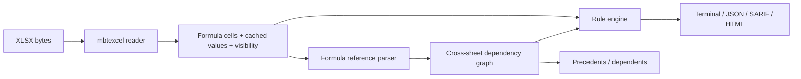

# SheetSentry

**Static analysis and dependency tracing for Excel models, written in MoonBit.**

SheetSentry reads `.xlsx` workbooks, parses formula references across sheets, builds a cell dependency graph, and reports model risks that are hard to see in Excel: error values, inconsistent formulas, hardcoded constants, volatile functions, hidden content, and circular references.

It is designed for finance, audit, FP&A, and data teams that want spreadsheet checks to run like code checks: deterministic, scriptable, and CI-friendly.

## Why

Spreadsheet errors are expensive and easy to miss:

- a formula is copied down a column but one row points at the wrong cell;
- a model output depends on a hidden sheet;
- a hardcoded growth rate is buried inside a formula;
- a circular reference only appears after a workbook is opened;
- an error value is cached behind a formula and never noticed.

Excel's built-in *Trace Precedents* / *Trace Dependents* are useful, but they are manual, single-cell, and not available in CI. SheetSentry makes the same ideas scriptable.

## Status

`0.3.0` MVP, implemented in MoonBit. The current release supports:

- XLSX reading through [`moonbitlang/mbtexcel`](https://mooncakes.io/docs/moonbitlang/mbtexcel)
- cross-sheet formula reference extraction
- dependency graph construction
- ten audit rules, baseline suppression, config files, and graph export
- terminal, JSON, SARIF, and self-contained HTML reports
- `trace` for precedents and dependents
- DOT / Mermaid dependency graph export
- JSON config files for rule filtering and ignored cells
- CI-friendly `--fail-on` exit codes and baselines

## Quick start

Requires the MoonBit toolchain.

```bash
moon update
moon check --target native
moon test --target native
moon run --target native cmd/main -- audit fixtures/bad_model.xlsx
```

Expected output:

```text
SheetSentry: fixtures/bad_model.xlsx
  sheets: 5  formula cells: 17  findings: 14
  high: 4  medium: 7  low: 3
  [medium] SS005  Opex!C6  Formula lives on a hidden row.
  [medium] SS003  Summary!B2  Formula embeds numeric constant 1.05; prefer a named input cell.
  [high] SS001  Summary!B4  Cell contains error value #REF!.
  ...
```

## CLI

```bash
# Terminal report
moon run --target native cmd/main -- audit model.xlsx

# JSON
moon run --target native cmd/main -- audit model.xlsx --format json --out findings.json

# SARIF for code scanning
moon run --target native cmd/main -- audit model.xlsx --format sarif --out results.sarif

# Self-contained HTML report
moon run --target native cmd/main -- audit model.xlsx --format html --out report.html

# Trace precedents (what this cell depends on)
moon run --target native cmd/main -- trace model.xlsx --cell "Summary!B7" --direction precedents --depth 4

# Trace dependents (what breaks if this cell changes)
moon run --target native cmd/main -- trace model.xlsx --cell "Inputs!B2" --direction dependents --depth 4

# Fail CI if any high-severity finding exists
moon run --target native cmd/main -- audit model.xlsx --fail-on high

# Create a baseline for existing findings
moon run --target native cmd/main -- audit model.xlsx --write-baseline baseline.json

# Fail only on new findings
moon run --target native cmd/main -- audit model.xlsx --baseline baseline.json --fail-on low

# Show only high-severity findings
moon run --target native cmd/main -- audit model.xlsx --min-severity high

# Disable noisy rules for a specific run
moon run --target native cmd/main -- audit model.xlsx --disable SS003,SS004

# Load a project config
moon run --target native cmd/main -- audit model.xlsx --config sheetsentry.json
```

## Rules

| ID | Severity | Rule | Why it matters |
| --- | --- | --- | --- |
| SS001 | High | Error value | `#REF!`, `#DIV/0!`, `#VALUE!`, `#N/A`, `#NAME?`, `#NUM!` silently poison downstream results. |
| SS002 | Medium | Formula inconsistency | One cell in a copied row/column uses a different formula pattern. |
| SS003 | Medium | Hardcoded constant | A numeric constant is embedded in a formula instead of living in an input cell. |
| SS004 | Low | Volatile function | `TODAY`, `NOW`, `RAND`, `RANDBETWEEN`, `OFFSET`, `INDIRECT`, `INFO`, `CELL` make results time- or environment-dependent. |
| SS005 | Medium | Hidden formula | Formulas on hidden sheets or hidden rows are easy to miss during review. |
| SS006 | High | Circular reference | A dependency cycle makes calculation order undefined or unstable. |
| SS007 | Low | Dynamic reference | `INDIRECT` / `OFFSET` prevent complete static dependency tracing. |
| SS008 | Medium | External workbook | Formula references another workbook, making the model non-self-contained. |
| SS009 | Low | Whole-axis reference | `A:A` / `1:1` can be expensive and ambiguous. |
| SS010 | Low | Missing cached value | Some readers may show a blank until the workbook is recalculated. |

The rule catalog is intentionally small and deterministic. Every finding has a stable rule ID, severity, sheet, cell, message, optional formula, and related cells.

## Config

```json
{
  "min_severity": "medium",
  "disabled_rules": ["SS004"],
  "ignore_cells": ["Summary!B2"],
  "fail_on": "high"
}
```

```bash
moon run --target native cmd/main -- audit model.xlsx --config sheetsentry.json
```

## Baseline

Large models often have known findings. Generate a baseline once, commit it, and let CI fail only on new findings:

```bash
moon run --target native cmd/main -- audit model.xlsx --write-baseline sheetsentry.baseline.json
moon run --target native cmd/main -- audit model.xlsx --baseline sheetsentry.baseline.json --fail-on low
```

A fingerprint is `rule|sheet|cell`, so moving a finding to another cell makes it new again.

## Reports

- **Terminal** — fast review in a shell.
- **JSON** — machine-readable for custom dashboards.
- **SARIF 2.1.0** — intended for GitHub Code Scanning and other SARIF consumers.
- **HTML** — a single self-contained file with summary cards and a findings table; no network or external assets.

## CI example

```yaml
- name: Audit Excel model
  run: |
    moon run --target native cmd/main -- \
      audit model.xlsx --format sarif --out results.sarif --fail-on high

- name: Upload SARIF
  if: always()
  uses: github/codeql-action/upload-sarif@v3
  with:
    sarif_file: results.sarif
```

The repository's own [`CI`](.github/workflows/ci.yml) runs `moon update`, `moon check`, `moon test`, and `moon build` on every push.

## Architecture



Core modules:

- `formula.mbt` — A1 / range / sheet-qualified reference extraction, normalization, function names, numeric literals.
- `audit.mbt` — workbook scan, dependency graph, rule engine, cycle detection.
- `trace.mbt` — graph construction and BFS traversal for precedents/dependents.
- `report.mbt` — terminal, JSON, SARIF, and HTML renderers.
- `cmd/main/main.mbt` — CLI.

## Testing

```bash
moon test --target native
```

Tests cover:

- reference extraction including quoted sheet names and absolute references;
- function-name and numeric-literal extraction;
- formula normalization across rows;
- all ten audit rules on `fixtures/bad_model.xlsx`;
- a clean workbook with zero findings;
- report rendering;
- baseline round-trip and suppression;
- severity and disabled-rule filters;
- graph export;
- rule catalog;
- 46 tests in total.
- precedents and dependents tracing;
- fail thresholds.

Fixtures are generated reproducibly with:

```bash
PYTHONPATH=../tools/pylib python3 scripts/make_fixtures.py
```

The Python script is a test-data generator only; the analyzer itself is MoonBit.

## Limitations

- XLSX only (no `.xls`, `.ods`, or Google Sheets yet).
- Formula references are extracted statically; `INDIRECT` and `OFFSET` are reported but cannot be fully resolved.
- Structured references (`Table1[Column]`) and external workbook links are not yet part of the dependency graph.
- Cycle detection currently reports simple dependency cycles; complex strongly connected components are on the roadmap.
- The rule engine is heuristic. Use the rule catalog and CI thresholds to fit your team's conventions.

## Roadmap

- Baseline file to suppress known findings and fail only on new ones.
- More rules: orphan calculations, external links, merged cells in data regions, inconsistent units, over-long formulas.
- Better cycle reporting with strongly connected components.
- `--fix` for safe, deterministic rewrites.
- WASM build so the report can run fully in a browser.

## License

Apache-2.0. See [LICENSE](LICENSE).

## Hackathon

Built for the 2026 MoonBit Hackathon, October season.
