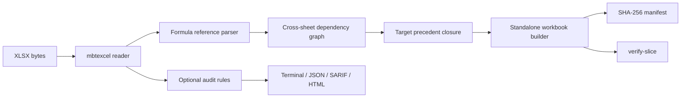

# SheetSentry 项目申报书

## 基本信息

- **项目名称**：SheetSentry：Excel 计算切片与模型审计
- **参赛者**：mhlagent
- **联系方式**：待填写
- **GitHub 仓库链接**：https://github.com/mhlagent/sheetsentry
- **项目方向**：MoonBit 数据处理 / 可复现计算切片 / 模型审计工具
- **是否为移植项目**：否，原创项目

## 项目简介

SheetSentry 是一个使用 MoonBit 编写的 Excel **计算切片（calculation slice）**工具，并附带一层可选的模型审计能力。

它解决的问题不是“再分析一遍公式结构”，而是：

> 给定一个目标单元格，如何从大型工作簿中提取出一个最小、可独立打开、可复现该计算结果的工作簿？

SheetSentry 会从目标单元格出发，沿公式依赖关系收集所有必要的前驱单元格，重新构建一个只包含所需工作表和单元格的独立 `.xlsx` 文件，并生成可校验的 JSON manifest：

- 源工作簿和切片工作簿的 SHA-256；
- 目标单元格及其前驱单元格清单；
- 目标值在提取前后的值；
- 切片是否完整（`complete`）；
- 无法静态解析的动态引用、命名区域、外部链接或缺失依赖；
- 用 `verify-slice` 重新打开切片并验证目标值。

这个问题在审计、财务模型复核、模型交接、监管报送和保密数据共享中非常实际：复核人通常只关心某个结果，却被迫拿到整个包含大量敏感数据的工作簿。SheetSentry 让“只共享复现这个结果所必需的模型部分”成为可脚本化、可验证的流程。

现有 MoonCell 侧重公式结构异常分析、版本比较和影响预览，并明确不写回 XLSX。SheetSentry 的独立核心是**计算切片提取、独立工作簿重构和可复现性验证**；公式规则、图查询和环检测只作为辅助诊断层，不作为主要创新点。

## 核心功能范围

### 1. 计算切片提取（独立核心）

- 输入：一个 `.xlsx` 工作簿、一个目标单元格（如 `Summary!B3`）、可选深度上限；
- 从目标单元格沿依赖图递归收集前驱单元格；
- 只保留被目标计算实际需要的 sheet 和 cell；
- 支持跨工作表引用、区域引用、绝对/相对引用；
- 将公式、缓存值和基本单元格类型写入新的独立工作簿；
- 排除与目标无关的工作表和数据，降低敏感信息暴露面；
- 对深度截断导致的缺失依赖显式标记，不把“能打开”误报成“完整”。

### 2. 可复现 manifest 与验证

- `source_sha256`：源工作簿内容哈希；
- `slice_sha256`：切片工作簿内容哈希；
- `included_cells` / `included_sheets`：切片范围；
- `target_value_before` / `target_value_after`：目标单元格值；
- `verified`：目标值是否一致；
- `complete`：是否存在未解析/未包含的依赖；
- `unresolved`：动态引用、命名区域、外部工作簿、缺失依赖等；
- `verify-slice` 命令重新打开切片并校验 manifest 中的目标值。

### 3. 辅助模型审计层

计算切片之外，SheetSentry 提供一层可选的模型审计规则，用于在切片前或评审时发现明显风险：

| 规则 | 级别 | 内容 |
| --- | --- | --- |
| SS001 | High | Excel 错误值（`#REF!`、`#DIV/0!`、`#VALUE!`、`#N/A` 等） |
| SS002 | Medium | 同一行/列公式模式不一致 |
| SS003 | Medium | 公式中硬编码数字常数 |
| SS004 | Low | 易失函数（`TODAY`、`NOW`、`RAND`、`OFFSET`、`INDIRECT` 等） |
| SS005 | Medium | 隐藏工作表或隐藏行中仍有公式 |
| SS006 | High | 循环引用 |
| SS007 | Low | 动态引用导致静态依赖不完整 |
| SS008 | Medium | 引用外部工作簿 |
| SS009 | Low | 整列/整行引用（如 `A:A`、`1:1`） |
| SS010 | Low | 公式没有缓存结果 |

辅助能力包括 terminal / JSON / SARIF / HTML 报告、baseline、`--min-severity`、`--disable`、`--config`。

### 4. 图与追踪（辅助基础设施）

- 依赖图用于计算切片；
- `trace` 用于查看前驱/后继，帮助解释切片范围；
- `graph` 导出 DOT / Mermaid；
- 环检测用于避免切片进入不可终止的依赖环。

这些能力是切片引擎的基础设施，不单独作为项目的核心创新主张。

## 与 MoonCell 的边界

| 能力 | MoonCell | SheetSentry |
| --- | --- | --- |
| 公式结构/邻域异常分析 | 是 | 是，作为辅助层 |
| 版本比较与影响预览 | 是 | 不是核心目标 |
| 人工审核会话与工作流 | 是 | 不是核心目标 |
| 生成独立切片 XLSX | 否 | **是，核心能力** |
| SHA-256 manifest + 完整性标记 | 否 | **是，核心能力** |
| 目标值提取前后校验 | 只做预览 | **是，切片后重新打开验证** |
| 只共享目标所需的 sheet/cell | 否 | **是，核心能力** |
| 图查询/环检测 | 部分/辅助 | 作为切片基础设施 |

SheetSentry 不与 MoonCell 竞争“谁更会分析公式”，而是把分析结果转化为**可交付、可复现、可验证的模型子集**。

## 预期验收产物

- Mooncakes 包：`mhlagent/sheetsentry`，当前目标版本 `0.4.0`；
- GitHub 仓库：https://github.com/mhlagent/sheetsentry；
- `slice` 命令：生成独立 `.xlsx` 和 manifest；
- `verify-slice` 命令：重新打开切片并验证目标值；
- 54 个 MoonBit 测试；
- 可复现的 `bad_model.xlsx` / `clean_model.xlsx` fixtures；
- 示例切片和 manifest；
- GitHub Actions：`moon update`、`moon check`、`moon test`、`moon build`、CLI smoke test；
- README、规则说明、架构说明、限制说明和比赛提交说明；
- Apache-2.0 许可证。

## 验收指标

- `moon check --target native` 通过；
- `moon test --target native`：54 个测试全部通过；
- `moon build --target native` 通过；
- `slice fixtures/bad_model.xlsx --target "Summary!B3"` 生成独立 XLSX；
- 切片包含 `Summary` 和 `Opex`，不包含无关的 `Tax` / `Scratch`；
- 切片目标值 `660` 与源工作簿一致，`verified=true`；
- 完整切片的 `complete=true`、`unresolved=[]`；
- 深度为 0 的切片明确报告 `complete=false` 和缺失依赖；
- `verify-slice` 能重新验证目标值，篡改期望值后返回失败；
- GitHub Actions 最新一次为绿色；
- `moon publish` 成功发布 `mhlagent/sheetsentry@0.4.0`。

## 技术方案

核心模块：

- `slice.mbt`：前驱闭包、独立工作簿重构、manifest、哈希、验证；
- `formula.mbt`：A1/区域/跨表/绝对引用解析、公式标准化；
- `trace.mbt`：依赖图构建、前驱/后继遍历；
- `audit.mbt`：辅助规则、环检测、过滤；
- `baseline.mbt` / `config.mbt`：审计层配置；
- `report.mbt`：审计报告；
- `cmd/main/main.mbt`：CLI。

依赖：

- `moonbitlang/mbtexcel@0.3.0`：XLSX 读写；
- `moonbitlang/x`：文件系统与 SHA-256；
- `moonbitlang/core/json`：manifest / config 解析。

限制：

- 切片保留公式与缓存值，但不承诺复制全部样式、图表、宏或外部链接；
- `INDIRECT` / `OFFSET` 无法完全静态解析，会在 manifest 中标记；
- 命名区域、结构化引用和外部工作簿依赖仍在后续范围；
- 深度截断的切片会被明确标记为不完整，不冒充完整模型。

## 移植或参考说明

- **原项目名称**：无直接上游项目，本项目为原创；
- **参考项目**：`moonbitlang/mbtexcel`（XLSX 读写）、Go `excelize`（mbtexcel 的上游）；MoonCell 是相邻的公式分析项目，本项目的切片/重构/验证核心与其不同；
- **原项目许可证**：不适用；
- **本项目许可证**：Apache-2.0；
- **代码来源说明**：项目代码为原创 MoonBit 实现；未复制 MoonCell 或参考项目的源代码；依赖库按其自身许可证使用；
- **AI 说明**：开发过程可使用 AI 辅助，但运行时切片、哈希和验证完全确定性，不依赖 LLM 或外部 AI 服务。

## 后续路线图

1. 多目标切片与批量切片；
2. 命名区域、结构化引用和外部工作簿依赖；
3. 保留更多样式/格式，生成可直接交付的审计包；
4. manifest 签名、审计回执和重放验证；
5. 切片策略：最小切片、完整切片、脱敏切片；
6. 大型工作簿 benchmark 和流式扫描；
7. WASM 构建，让浏览器端也能生成和验证切片。

## 比赛信息

- 赛事：2026 MoonBit Hackathon · 十月赛
- 截止时间：2026-10-31
- 项目方向：数据处理 / 可复现计算切片 / 模型审计
- 仓库：https://github.com/mhlagent/sheetsentry
- Mooncakes：https://mooncakes.io/docs/mhlagent/sheetsentry
