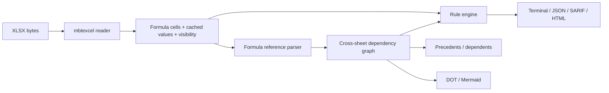

# SheetSentry 项目申报书

## 基本信息

- **项目名称**：SheetSentry：Excel 模型静态分析与依赖追踪
- **参赛者**：mhlagent
- **联系方式**：待填写
- **GitHub 仓库链接**：https://github.com/mhlagent/sheetsentry
- **项目方向**：MoonBit 数据处理 / 开发者工具 / 表格模型静态分析
- **是否为移植项目**：否，原创项目

## 项目简介

SheetSentry 是一个使用 MoonBit 编写的 Excel 模型静态分析与依赖追踪工具。它读取 `.xlsx` 工作簿，解析公式中的单元格引用、区域引用、跨工作表引用和命名区域，构建单元格依赖图，并自动发现模型中的高风险问题。

项目面向财务建模、审计、FP&A、咨询、数据分析和需要批量处理 Excel 的工程团队。传统 Excel 模型主要依赖人工 Review，Excel 自带的 Trace Precedents / Trace Dependents 只能一次查看一个单元格，难以批量、跨表、在 CI 中重复执行；商业表格审计工具通常闭源且价格较高。

SheetSentry 把这些检查变成可脚本化、可重复、可进入 CI 的工程流程：

- 找出 `#REF!`、`#N/A`、`#DIV/0!` 等错误值；
- 找出复制公式时产生的行/列不一致；
- 找出公式中写死的数字常数；
- 找出隐藏工作表、隐藏行中的公式；
- 找出循环引用和外部工作簿引用；
- 输出终端、JSON、SARIF 和自包含 HTML 报告；
- 追踪任意单元格的前驱和后继依赖；
- 导出 DOT / Mermaid 依赖图；
- 用 baseline 只阻断新增问题。

项目的主要实现语言是 MoonBit，XLSX 读取基于 `moonbitlang/mbtexcel`。运行时不需要 Excel、LibreOffice、浏览器插件或 AI 服务，结果确定、可复现。

## 核心功能范围

### 1. XLSX 读取与公式解析

- 读取工作表、单元格值、公式、隐藏工作表、隐藏行；
- 解析 A1、`$A$1`、`A1:B10`、`Sheet1!A1`、`'Sheet 1'!A1` 等引用；
- 支持跨工作表引用、区域展开、公式标准化；
- 提取函数名、数字字面量、动态引用和外部工作簿引用；
- 对 `INDIRECT`、`OFFSET` 等无法完全静态解析的引用给出 SS007 提示。

### 2. 审计规则

| 规则 | 级别 | 内容 |
| --- | --- | --- |
| SS001 | High | Excel 错误值（`#REF!`、`#DIV/0!`、`#VALUE!`、`#N/A` 等） |
| SS002 | Medium | 同一行/列公式模式不一致 |
| SS003 | Medium | 公式中硬编码数字常数 |
| SS004 | Low | 易失函数（`TODAY`、`NOW`、`RAND`、`RANDBETWEEN`、`OFFSET`、`INDIRECT` 等） |
| SS005 | Medium | 隐藏工作表或隐藏行中仍有公式 |
| SS006 | High | 循环引用 |
| SS007 | Low | 动态引用导致静态依赖不完整 |
| SS008 | Medium | 引用外部工作簿 |

### 3. 依赖图与追踪

- 构建跨工作表单元格依赖图；
- `trace --direction precedents` 查看某个结果依赖了谁；
- `trace --direction dependents` 查看修改某个输入会影响谁；
- `graph --format dot` / `graph --format mermaid` 导出依赖图；
- 对区域引用设置展开上限，避免超大范围导致内存爆炸。

### 4. 报告与 CI

- Terminal：快速本地查看；
- JSON：机器可读，便于二次处理；
- SARIF 2.1.0：可接入 GitHub Code Scanning 等工具；
- HTML：单文件、无外部依赖，支持按严重级别、规则和关键词过滤；
- `--fail-on high|medium|low`：达到阈值时返回非零退出码；
- `--baseline` / `--write-baseline`：只阻断新增问题；
- `--min-severity`：按最低严重级别过滤；
- `--disable SS003,SS004`：临时关闭指定规则。

### 5. CLI

```bash
sheetsentry audit model.xlsx
sheetsentry audit model.xlsx --format json --out findings.json
sheetsentry audit model.xlsx --format sarif --out results.sarif
sheetsentry audit model.xlsx --format html --out report.html
sheetsentry audit model.xlsx --baseline baseline.json --fail-on high
sheetsentry trace model.xlsx --cell "Summary!B7" --direction precedents --depth 4
sheetsentry graph model.xlsx --format mermaid --out graph.mmd
sheetsentry rules
```

## 预期验收产物

- Mooncakes 包：`mhlagent/sheetsentry`，当前已发布 `0.2.0`；
- GitHub 仓库：https://github.com/mhlagent/sheetsentry；
- 可直接运行的 MoonBit CLI：`cmd/main`；
- 可复用的 MoonBit 库 API：`audit_bytes`、`build_graph_bytes`、`trace_bytes`、`filter_report`、`apply_baseline`、`graph_to_dot`、`graph_to_mermaid` 等；
- 19 个 MoonBit 测试；
- 可复现的 `bad_model.xlsx` / `clean_model.xlsx` 测试 fixtures；
- GitHub Actions CI：`moon update`、`moon check`、`moon test`、`moon build`、CLI smoke test；
- README、规则目录、架构说明、限制说明和比赛提交说明；
- Apache-2.0 许可证；
- 可选的 SARIF / HTML / JSON 演示产物。

## 与现有 MoonBit 生态的差异

| 已有项目 | 已有能力 | SheetSentry 的差异 |
| --- | --- | --- |
| `moonbitlang/mbtexcel` | XLSX 读写、公式计算 | 不做模型审计、依赖图、规则引擎和 CI 报告 |
| `moonbitlang/office` | Agent 友好的 XLSX/DOCX 查询 CLI | 不做风险规则、baseline 和依赖追踪 |
| `partsieve` | OOXML 能力审计、受限重建 | 不分析公式语义和跨表依赖 |
| `yxl` | YAML → XLSX 编译 | 不是审计工具 |
| `moonrow` | CSV 快照对比 | 不覆盖 XLSX 公式和跨工作表依赖 |

SheetSentry 的重点不是“再写一个 XLSX 解析器”，而是“Excel 模型是否健康、改动会影响谁”的分析工作流。

## 技术方案



核心模块：

- `formula.mbt`：引用解析、公式标准化、函数名和数字字面量提取；
- `audit.mbt`：工作簿扫描、依赖图、规则引擎、DFS 环检测、过滤；
- `trace.mbt`：依赖图构建和 BFS 前驱/后继追踪；
- `graph_export.mbt`：DOT / Mermaid 导出；
- `baseline.mbt`：baseline 解析和生成；
- `report.mbt`：Terminal / JSON / SARIF / HTML 渲染；
- `cmd/main/main.mbt`：CLI。

依赖：

- `moonbitlang/mbtexcel@0.3.0`：XLSX 读取；
- `moonbitlang/x`：文件系统等基础能力；
- `moonbitlang/core/json`：baseline JSON 解析。

当前限制：

- 仅支持 XLSX，不支持旧版 `.xls`、ODS、Google Sheets；
- `INDIRECT` / `OFFSET` 只能提示，不能完全静态解析；
- 结构化引用（`Table1[Column]`）和外部工作簿依赖图仍在后续范围；
- 目前面向中小型工作簿，超大工作簿的性能基准和流式扫描是后续优化方向。

## 验收指标

- `moon check --target native` 通过；
- `moon test --target native`：19 个测试全部通过；
- `moon build --target native` 通过；
- `bad_model.xlsx` 能发现 12 个问题，覆盖 SS001–SS008；
- `clean_model.xlsx` 输出 0 个问题；
- `--fail-on high` 对有高风险问题的模型返回非零；
- 使用 baseline 后，已知问题被抑制，`--fail-on low` 返回 0；
- `graph` 能输出 DOT 和 Mermaid；
- GitHub Actions 最新一次为绿色；
- `moon publish` 成功发布 `mhlagent/sheetsentry@0.2.0`。

## 移植或参考说明

- **原项目名称**：无直接上游项目，本项目为原创；
- **参考实现**：XLSX 读取依赖 `moonbitlang/mbtexcel`（其上游为 Go `excelize`）；审计规则参考电子表格审计领域的常见检查（公式一致性、硬编码常数、循环引用、隐藏依赖等）；
- **原项目许可证**：不适用；
- **本项目许可证**：Apache-2.0；
- **代码来源说明**：项目代码为原创 MoonBit 实现；未复制任何参考项目的源代码；依赖库按其自身许可证使用；
- **AI 说明**：开发过程可使用 AI 辅助，但运行时分析完全确定性，不依赖 LLM 或外部 AI 服务；每条 finding 都可追溯到规则 ID、工作表、单元格和公式。

## 后续路线图

1. 增加更多规则：孤儿计算、合并单元格数据区、过长公式、命名区域重复/断链；
2. 支持外部工作簿依赖图和结构化引用；
3. 用 SCC（强连通分量）输出更精确的循环引用报告；
4. 增加大型工作簿 benchmark 和流式扫描；
5. 增加 WASM 构建，让 HTML 报告可以在浏览器本地分析；
6. 增加配置文件和更细粒度的规则开关；
7. 对常见财务模型建立公开测试集和差分测试。

## 比赛信息

- 赛事：2026 MoonBit Hackathon · 十月赛
- 截止时间：2026-10-31
- 项目方向：数据处理 / 开发者工具
- 仓库：https://github.com/mhlagent/sheetsentry
- Mooncakes：https://mooncakes.io/docs/mhlagent/sheetsentry
